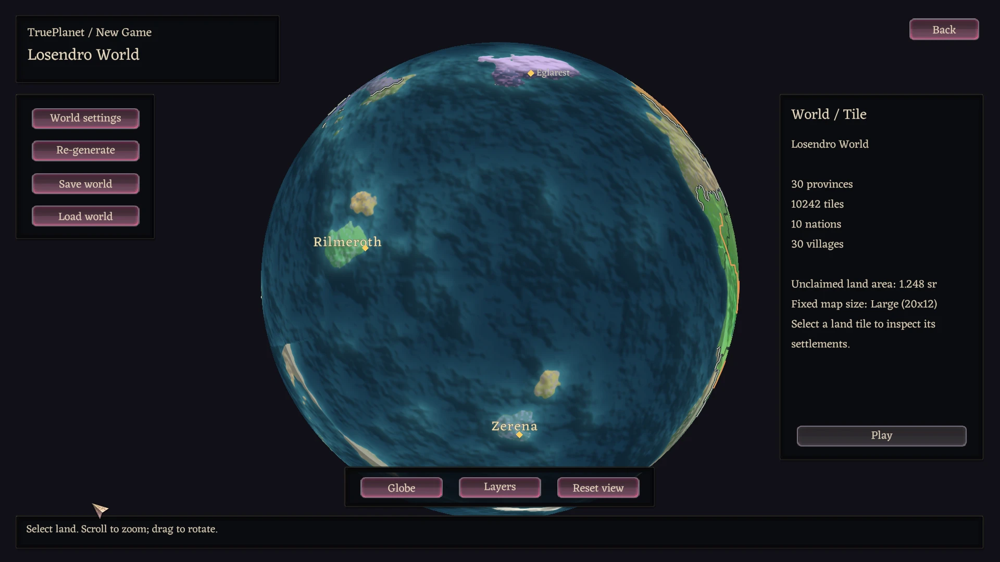

# RuinarchMods

Gameplay changes, performance fixes and a planet atlas for **Ruinarch**.
Choose the packages you want; they patch the stock game at runtime through
[RuinarchModLoader](https://github.com/Xm0x/RuinarchModLoader).

[Install](#install-a-package) · [Choose mods](#choose-your-mods) · [Build and verify](#build-and-verify)

## Install a package

1. Install [RuinarchModLoader](https://github.com/Xm0x/RuinarchModLoader/releases).
   Check each mod's minimum version: Ruinarch+ 0.12.1 and TruePlanet 0.3.1 need 0.9.0;
   Performance Mod 0.4.1 needs 0.8.0 or newer.
   Use loader 0.9.1 for shared native loading feedback.
2. Subscribe to a package's Workshop item, or download its ZIP from
   [releases](https://github.com/Xm0x/RuinarchMods/releases) and extract its mod
   folder into the game's `Mods/` directory.
3. Restart Ruinarch. Inspect packages and enable/disable them in the main-menu
   **Mods** window. If both local and Workshop copies exist, the local copy wins.

Normal mod deployment does not replace the game with a rebuilt DLL. The loader's
installer adds its startup call to your own stock assembly; gameplay patches run
through Harmony afterward.

## Choose your mods

### [Ruinarch+](RuinarchPlus/README.md)

Changes how villages live and respond to you: corpse decay and burial, witnesses
and gossip, books and Libraries, births and aging, migration, famine, uprisings,
hunting, trade, night watches and spreading blight. It also fixes stock-game bugs.
Features can be switched off individually in **Settings > Mods > Ruinarch+**.

[Steam Workshop](https://steamcommunity.com/sharedfiles/filedetails/?id=3811868047) ·
[Feature and settings guide](RuinarchPlus/README.md)

### [Performance Mod](RuinarchPerformance/README.md)

Reduces listener overhead and loading work without changing gameplay or native
save formats. Optional selected-save preloading trades RAM and background frame
pacing for a shorter transition. Works with or without Ruinarch+.

[Steam Workshop](https://steamcommunity.com/sharedfiles/filedetails/?id=3813240118) ·
[Measurements and tradeoffs](RuinarchPerformance/README.md)

### [TruePlanet](TruePlanet/README.md)

A seeded globe with political provinces, settlements and land-only orange roads.
Select geographic tiles or wilderness to play; return visits restore native maps.
Only one map runs at a time. Works without Ruinarch+.

TruePlanet **0.3.1** adds responsive generation, a cached gameplay atlas beside
Achievements and persistent planet-wide subjugation. Loader **0.9.1** supplies
the shared native generation/save-loading progress display.

[Steam Workshop](https://steamcommunity.com/sharedfiles/filedetails/?id=3819054263) ·
[Download 0.3.1](https://github.com/Xm0x/RuinarchMods/releases/tag/trueplanet-v0.3.1) ·
[Controls and compatibility](TruePlanet/README.md)



Actual native UI from the 0.3.0 qualification run, scaled for this README.
This is not a simulated product mockup.

### RuinarchDebug is for development

An in-game overlay and unattended native scenario harness. It can spawn or kill
characters, control time and place buildings. Do not install it for normal play.


## Content and artwork

Village buildings reuse the game's tiles and objects at runtime: the Mass Grave
uses a dirt floor and the Town Hall uses a Tavern look. The Blight Heart ships
mod-authored artwork. No game binaries or extracted stock assets are bundled here.

New buildings, skills and actions use the loader's
[content framework](https://github.com/Xm0x/RuinarchModLoader/blob/master/docs/CONTENT_FRAMEWORK.md).
[RuinarchRE](https://github.com/Xm0x/RuinarchRE) supplies the reference used to choose
native patch targets. See [ARCHITECTURE.md](ARCHITECTURE.md) for the repository boundaries.

## Build and verify

Mods are built with `tools/build-mod.sh` from a RuinarchModLoader checkout:

```bash
tools/build-mod.sh /path/to/RuinarchMods/RuinarchPlus "/path/to/Ruinarch/Mods"
```

`tools/run-autotest.sh` in the same repo runs the RuinarchDebug test harness in the game.

During development, run affected suites before full release regressions:

```bash
tools/run-autotest.sh 1200 "RecordsSuite,UnrestSuite,DecayTest"
```

The timeout is wall-clock protection, not a requested run duration. Checks use
actual native behavior; unavailable fixtures are not treated as passes.

<details>
<summary>Native harness conventions and recorded 0.12.1 qualification</summary>

Checks stop when their required behavior is observed. `DecayTest` temporarily
uses the supported
quarter-day decay setting, verifies all four stages and the decay bar, then restores the
original setting. Missing-persons tests finish when their cases are settled; valid failed
searches still exercise all three attempts and the increasing retry intervals. Burial fixtures
bring an eligible resident home if needed; gossip fixtures start with two factions and
maintain the meeting until the native sighting occurs. The migration corpse check compares
gains with and without one body, so earlier deaths do not invalidate it. Full runs remain
the release gate.

Town construction checks require the village to remain above the configured Town threshold;
population loss is reported as an unavailable fixture, not a missing Town promotion.
Library construction checks use the authored Library's actual footprint, clear competing
placement jobs in the test world, and supply the required materials to the existing native
build job. A real villager must finish construction; the construction check never uses an
instant build as a substitute.
Template fixtures find a connector for the exact exported or resized prefab they place,
not for a randomly selected native look of the same building kind. Placement uses the
native settlement-owned job and an eligible placer, preserving the village's
one-blueprint-job guard. The build fixture keeps its worker rested; sleep is not under test.
Succession checks invoke the native faction-leader ruler reassignment directly, rather than
assuming no unrelated ruler changes occur over six hours. Jailing checks distinguish native
escape rolls, release by friends and release by outsiders, including release before delivery.
Trader delivery checks observe the native cargo deposit in the destination stockpile,
not only the mod's delivery announcement.
Blight cleanup checks allow a native work/sleep cycle and stop on actual cleanup progress;
they do not require sleeping villagers to purify ground overnight.
Stock-rule fixtures exit native character states before destroying markers and cleaning
components; otherwise combat signal listeners can outlive their owner.
No-scatter checks accept a named native Mass Grave burial with no corpse or gravestone.
Migration scaling includes an already-abandoned village's valid zero multiplier.
Missing-person discovery keeps corpse decay disabled only for that fixture, restoring its
previous setting afterward, so delayed party formation does not erase the body under test.
Portal-witness fixtures process native line-of-sight immediately, then move the living
carrier off the Portal's defended ground before advancing the simulation.

Ruinarch+ 0.12.1 qualified with two complete native full runs on 2026-10-06:
run 8 passed 303 checks (0 failed, 25 unavailable fixtures); run 9 passed 316
(0 failed, 22 unavailable fixtures). Both had no game exceptions/errors and preserved
player mod settings byte-identically. Earlier unexplained native termination and Heart
destruction remain recorded as cause-unestablished, not claimed fixed.

</details>

<details>
<summary>Source map for mod authors</summary>

## Layout

```
RuinarchPlus/
  RuinarchPlus.cs            entry point: applies the patches, registers the buildings
  Config.cs                  options shown in the Settings window (Mods tab)
  SettingsMigration.cs       moves options from the old config.json into the settings file
  ModBuildings.cs            villagers build Ruinarch+ buildings (shared construction)
  Fixes/                     one Harmony patch class per bug fix
  Phase2/                    death, decay and disease
    CorpseDecay*.cs          unburied bodies rot and disappear; the decay bar
    CorpseDisease.cs         rotting bodies spread plague
    Curfew.cs                plague curfew
    MassGrave*.cs            the Mass Grave: structure, burial, construction, dirt floor
  Phase3/Knowledge*.cs       per-faction list of known demonic structures; what it gates
  Phase3/MissingPersons*.cs  missing residents and search parties
  Phase4/MigrationHealth.cs  migration follows village health
  Phase5/SettlementTiers.cs  Village, Town, City
  Phase5/TownHall.cs         the Town Hall building
  Phase5/Famine.cs           famine: starving villages, people moving away
  Phase7/                    Blight Hearts, spreading corruption, village response and fire
  RuinarchPlus-DESIGN.md     design notes and roadmap
RuinarchPerformance/
  RuinarchPerformance.cs     entry point
  TileObjectListeners.cs     tile objects behind one signal listener
  TileObjectLoading.cs       linear native save loading with mutation-safe ordinals (unpublished)
  JobCrimeListeners.cs       finished jobs drop their crime listener
  MinimapRedraw.cs           the minimap redraws only when it changes
  FrameRateCap.cs            the frame rate cap follows the screen or the player's setting
  PerformanceSettings.cs     options shown in the Settings window (Mods tab)
TruePlanet/
  TruePlanet.cs             settings, native names and New Game integration
  PlanetModel.cs            atlas data and graph/reference validation
  TileMesh.cs               deterministic fine spherical cells and indexed lookup
  TileLand.cs               sampled dry-land areas and adjacency
  NationalProvinces.cs      nation-first claims and connected subdivision
  TileProvinces.cs          legacy ownership reconstruction and validation
  TileRoads.cs              land-only settlement routes on fine cell adjacency
  PlanetGenerator.cs        orchestrates geography, nations, provinces and roads
  PlanetGeography.cs        continuous spherical height/climate and local coordinates
  TileGame.cs               native geographic generation and early save restoration
  LegacyProvinceGame.cs     versioned native province execution
  TileStore.cs              immutable native snapshots and atomic campaign revisions
  TileTravel.cs             single-scene travel, recovery and campaign Portal loss
  CampaignCarry.cs          portable currencies and skill progression
  PlanetStore.cs            independent transactional JSON world saves
  PlanetSurface.cs          shared cached terrain/political raster and geographic picking
  PlanetGlobe.cs            isolated 3D sphere camera and owned render target
  GlobeOverlays.cs          horizon-clipped screen-space borders, roads and labels
  GlobeSkin.cs              borrowed native artwork and safe floating controls
  GlobeProjection.cs        sphere-ray intersection and smooth UV mesh
  AtlasInputScope.cs        exact source input capture and restoration
  PlanetCanvas.cs           optional flat map, labels, zoom/pan and shared picking
  MapGeometry.cs            shared spherical edges, land clipping and seam splits
  MapLines.cs               anti-aliased vector borders and continuous thin orange roads
  MapTerritories.cs         connected land components and owned-land nation label fitting
  PlanetView.cs             native floating HUD, drawers and selection inspector
RuinarchDebug/
  DebugMenu.cs               in-game overlay
  AutoTest.cs                unattended in-game test harness
  TemplateSuite.cs           template export, rebuilding, packs and native construction checks
  BlightSuite.cs             blight growth, village rules, crops, feeding, save and fire checks
  PerformanceSuite.cs        Performance Mod checks (signals, disconnects, loading ordinals, reload)
  ModSettingsSuite.cs        mod settings checks (files, values, the Mods tab)
  SpiritEnergyCostSuite.cs   spirit-energy cost settings, rounding and disabled-cost checks
  TableCannibalSuite.cs      direct/table meat trait and alert parity, food buffs and exclusions
  FrozenVigilantSuite.cs     frozen/thawed Vigilant stealth interception
  HarpyDragonSuite.cs        wild/agitated dragon exclusion and eligible prey
  ExileJurisdictionSuite.cs  cross-faction sentencing, bans, clan preservation and grudges
  CultistRemovalSuite.cs     actual map nameplate after cultist removal, with visual capture
  CurfewVisitSuite.cs        active/queued visit cancellation under curfew and native-rule controls
  CorpseReloadSuite.cs       native save/reload without stale corpse references
  Stock*Suite.cs             Discord-report fixes, eligibility controls and native UI checks
  PlusBridge.cs              reaches Ruinarch+ by reflection (no hard dependency)
tools/
  publish-workshop.sh        uploads a mod as a new version of its Steam Workshop item
  WorkshopPublish/           the one-launch game tool that script installs
ARCHITECTURE.md              how the three repos fit together
```

</details>

<details>
<summary>Workshop release tooling</summary>

## Releasing on the Steam Workshop

Ruinarch+ is also published as Workshop item
[3811868047](https://steamcommunity.com/sharedfiles/filedetails/?id=3811868047), and the
Performance Mod as
[3813240118](https://steamcommunity.com/sharedfiles/filedetails/?id=3813240118). Each
release uploads the new version there too:

```bash
tools/publish-workshop.sh RuinarchPlus 3811868047 "Ruinarch+ 0.12.1: <what changed>"
tools/publish-workshop.sh RuinarchPerformance 3813240118 "Performance Mod 0.4.1: <what changed>"
```

TruePlanet is Workshop item
[3819054263](https://steamcommunity.com/sharedfiles/filedetails/?id=3819054263).
Its first Workshop upload used the exact qualified 0.3.0 GitHub package and verified
all three downloaded file hashes. The release script rebuilds source; do not use it
when a release must retain a previously qualified DLL unchanged.

The script builds the mod into a clean folder (the DLL, `mod.json`, `README.md`, an
optional `preview.png`, and any `art/`, `audio/`, `bundles/` or `templates/`, never a player's `config.json`), then starts Ruinarch
through Steam once with a small release tool installed. That tool uploads the folder through
the game's own Steam session, which needs no password, writes the result and quits. Only
the files and the change note change; the title, description, images and visibility stay
as they were set on the item's Steam page. It needs Steam running and logged in as the
item's owner, the game closed, and the RuinarchModLoader checkout next to this repo (or
`RUIN_LOADER_DIR`), built and installed in the game.

For a mod that is not on the Workshop yet, pass `new` instead of an item id. The script
creates a public item titled with the mod's `mod.json` name and tagged `RuinarchModLoader`
(the tag the loader's own Workshop upload uses). Its description says the mod needs the
loader and then gives the `mod.json` description. The new item's id is printed; add it here.

</details>

## Project notes

AI assistance was used in this project. Ruinarch and its assets belong to their
respective owners; these are independent fan-made mods, not official game releases.
