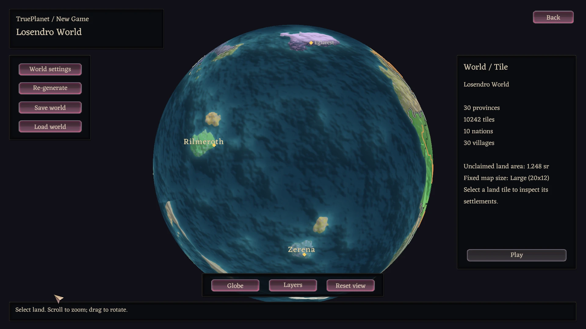

# Ruinarch mods

Give Ruinarch villages families, trade, and political unrest with Ruinarch+;
reduce loading delays with Performance Mod; or play across a planet with
TruePlanet. Install the mods you want. Each works without the others.

## Choose a mod

| Mod | What it does |
|---|---|
| [Ruinarch+](RuinarchPlus/README.md) | Villagers bury their dead, share news, keep books, raise families, trade food, and rebel against their rulers. Adds spreading blight and game bug fixes. |
| [Performance Mod](RuinarchPerformance/README.md) | Reduces loading work and some causes of stuttering, with optional save preloading and settings for high-refresh screens. |
| [TruePlanet](TruePlanet/README.md) | Generates a globe of nations, settlements, and wilderness. Travel between local maps and subjugate the planet in one campaign. |

## Install

You need your own copy of Ruinarch and
[RuinarchModLoader](https://github.com/Xm0x/RuinarchModLoader).
The loader adds the in-game mod manager and lets Ruinarch run these mods.

1. Install [RuinarchModLoader](https://github.com/Xm0x/RuinarchModLoader/releases).
2. Subscribe to the mods you want:
   [Ruinarch+](https://steamcommunity.com/sharedfiles/filedetails/?id=3811868047),
   [Performance Mod](https://steamcommunity.com/sharedfiles/filedetails/?id=3813240118),
   or [TruePlanet](https://steamcommunity.com/sharedfiles/filedetails/?id=3819054263).
3. Restart Ruinarch. Open **Mods** on the main menu to see your installed mods.

For a manual installation, download a mod's ZIP from
[GitHub releases](https://github.com/Xm0x/RuinarchMods/releases) and extract
its folder into the game's `Mods/` folder instead of subscribing on Workshop.

Open **Settings > Mods** to change a mod's options. Enable or disable whole
mods from the main-menu **Mods** window, then restart the game.

## Before you play

Ruinarch+ changes village behavior automatically. Its Blight Heart is in your
Build menu; villagers construct Mass Graves, Town Halls, and Libraries themselves.

TruePlanet opens its globe when you choose **New Game**. Select land and click
**Play**. During a campaign, open **Planet atlas** beside **Achievements** to
travel elsewhere. In version 0.4.0, only the map you are viewing runs; other
maps wait until you return.

Performance Mod needs no setup. If save preloading causes stutters or uses too
much memory, turn off **Preload selected saves** in its settings.

## Help and mod creation

Each mod's page explains its features, controls, settings, and compatibility.
Report problems through [GitHub issues](https://github.com/Xm0x/RuinarchMods/issues)
with the mod version and what happened.

To make your own mods, use the
[mod author guide](https://github.com/Xm0x/RuinarchModLoader/blob/master/docs/WRITING_MODS.md).
[ARCHITECTURE.md](ARCHITECTURE.md) describes the source repositories.
RuinarchDebug is a developer tool, not a mod needed for normal play.

These are independent fan-made mods. Ruinarch and its assets belong to their
respective owners. AI assistance was used in development.
