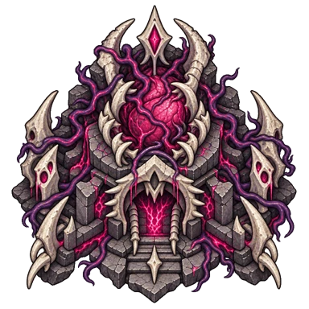

# Ruinarch+

Make Ruinarch's villages change over time. Villagers raise families, bury their
dead, trade food, keep records of your buildings, and turn against rulers who
fail them. Witnesses and gossip determine what they know about you.

Ruinarch+ also adds the Blight Heart, a demonic building that spreads corruption,
and fixes bugs in the base game. You can turn individual gameplay features
off in the game's settings.

[Steam Workshop](https://steamcommunity.com/sharedfiles/filedetails/?id=3811868047)
| [Download 0.12.1](https://github.com/Xm0x/RuinarchMods/releases/tag/ruinarch-plus-v0.12.1)

## Install and play

Requires [RuinarchModLoader 0.9.0 or newer](https://github.com/Xm0x/RuinarchModLoader).
Install the loader first, subscribe to Ruinarch+ on Steam Workshop, then
restart Ruinarch. The main-menu **Mods** window should list Ruinarch+.

For a manual installation, download `RuinarchPlus-0.12.1.zip` from the release
and extract its `RuinarchPlus` folder into the game's `Mods/` folder instead
of subscribing on Workshop.

Village features run automatically. Villagers construct Mass Graves, Town
Halls, and Libraries when they need them; you do not place these buildings.
The Blight Heart is in your Build menu.

## Witnesses, gossip, and secrets

A villager who sees one of your buildings must return home alive to report
it. Other villages learn through visitors, parties, and gossip. Counterattacks
go after buildings the village knows about, instead of heading straight for
an undiscovered Portal.

Open **Who Knows of You** in the bookmarks panel to see which factions know
about your buildings and who is carrying news home. Click an entry to select
the faction or witness.

Knowledge lives in people. A village can forget your buildings when the people
who remember them die or lose their memories. Homes and Libraries preserve
written records; villagers write down what they know and read what they have
forgotten. Destroying the books destroys those records.

When someone goes missing, search parties visit the place where they were
last seen. They do not automatically know where every captive is held.

## Death, disease, and burial

Unburied bodies rot and eventually disappear. Rotting corpses in a settlement
can spread plague. A body being carried pauses its decay; buried and
mummified bodies do not rot.

Villages build a Mass Grave for bodies they cannot bury in a Cemetery or
Cult Temple, including animal carcasses. Residents still go to their own
Cemetery when one is available. Villagers collect bodies from the village
and nearby land instead of scattering graves across the wilderness.

A ruler who responds to plague with Quarantine or Exile also sends residents
home during their free time. Work, care, and burials continue. The village
turns away visitors and traders until the curfew ends.

## Families and growing settlements

Villagers have children, grow up, and die of old age. Children are smaller,
do not work or fight, and cannot become rulers. Adults take up trades.
Living animals and monsters also age; some kinds have young.

A village with enough people builds a Town Hall and becomes a Town, then a
City, with room for more homes and facilities. The default thresholds are
20 and 40 residents. Losing the Town Hall removes that status.

Migration follows a village's condition. Plague, famine, attacks, abandoned
homes, and unburied bodies make it less attractive to settlers. Your
Induce Migration power still works.

## Food, rulers, and night guards

Hungry villages send hunters to bring back meat. Villages with surplus food
send traders to places that need it. Traders also carry news of your buildings.

Famine stops new settlers and can drive starving residents to another village.
Plague, deaths, homelessness, food shortages, and other troubles build unrest
against the ruler. An uprising can become a brawl, an assassination plot,
the ruler's imprisonment, or a civil war.

Towns, Cities, and capitals with enough fighters keep a night watch. Guards
sleep by day and patrol at night. They are not sent hunting or trading.

## Spread the blight

Build a Blight Heart to spread corruption around it. Deaths on its corrupted
ground feed the Heart through three levels, increasing its reach and strength.
Select the Heart to see its level, feeding, and patch size.

Blight can spread into village streets and fields. Crops wither, and villagers
try to clean the ground. A large outbreak raises an alarm and adds unrest.
Fire cleanses corrupted ground when it burns out, but keeps its normal damage
and spread. Destroying a Heart stops its growth; the corruption remains.

Village blight does not let you place summons or demonic buildings on village
ground. Hearts share a limit on how much corruption they can add each hour.

## Bug fixes

Ruinarch+ fixes problems with spells, prisoners, villagers, and buildings,
including these:

- Poison and frozen explosions and chain lightning caused by your side spare
  your demonic buildings and walls.
- Released prisoners do not leave your base with a queued report of the Portal.
- Demonic construction refuses indestructible objects instead of deleting them.
- Frozen Vigilant characters cannot intercept stealth actions.
- Villagers stop attacks when the target's faction is no longer hostile.
- Recuperating stops suppressing hunger, tiredness, and boredom when recovery ends.
- Purified cultists return to their race's normal religion.
- Eye Wards require their resource cost before placement.

## Change the settings

Open **Settings > Mods > Ruinarch+** from the main menu or during play.
Options cover burial, disease, knowledge, searches, ageing, population growth,
food, uprisings, night guards, and blight. Most gameplay features start enabled.
Skipping the tutorial is off by default.

You can change population thresholds, lifespans, decay time, search intervals,
and other values there. Settings changes apply immediately and are kept when
the mod is updated. Turning off blight stops its growth; it does not remove
existing Hearts or corruption.

Report problems through [GitHub issues](https://github.com/Xm0x/RuinarchMods/issues).
Include your Ruinarch+ and loader versions, what happened, and which settings
you changed.

Ruinarch+ is an independent fan-made mod. Ruinarch and its assets belong to
their respective owners.
