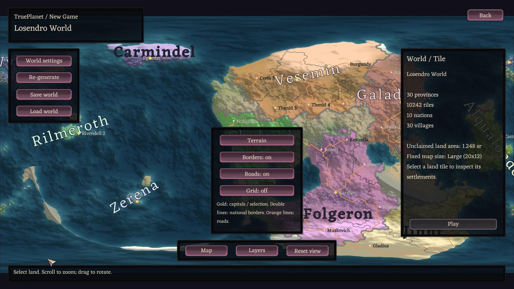

# TruePlanet 0.3.1

Generate a seeded planet, inspect it on a rotatable globe and play its geographic
tiles. Nations, settlements and orange roads share one world; unclaimed land is
playable wilderness. Works without Ruinarch+.

[Steam Workshop](https://steamcommunity.com/sharedfiles/filedetails/?id=3819054263) ·
[Download 0.3.1](https://github.com/Xm0x/RuinarchMods/releases/tag/trueplanet-v0.3.1) ·
[Loader 0.9.1](https://github.com/Xm0x/RuinarchModLoader/releases/tag/v0.9.1)

> [!IMPORTANT]
> 0.3.1 adds responsive atlas generation, a cached gameplay atlas and persistent
> planet-wide subjugation. Use loader **0.9.1** for shared native loading feedback;
> the mod remains compatible with the 0.9.0 core/framework.

[Install](#install) · [Play and travel](#play-and-travel) · [Options](#options) · [Verification](#verification-and-measured-limits)


Native 0.3.0 UI from the qualified build, scaled for this README. Drag to rotate,
scroll to zoom, then select land to play. The **Globe / Map** button changes the view.

## Install

1. Install [RuinarchModLoader 0.9.1](https://github.com/Xm0x/RuinarchModLoader/releases/tag/v0.9.1)
   first; TruePlanet does not replace the loader.
2. Subscribe on [Steam Workshop](https://steamcommunity.com/sharedfiles/filedetails/?id=3819054263),
   or extract `TruePlanet-0.3.1.zip` from
   [the release](https://github.com/Xm0x/RuinarchMods/releases/tag/trueplanet-v0.3.1)
   into the game's `Mods/` directory, producing `Mods/TruePlanet/`.
3. Restart Ruinarch. Use one distribution path: a local copy takes precedence
   when local and Workshop packages both exist.

Do not downgrade conquest-bearing 0.3.1 saves to the 0.3.0 reader.

## Play and travel

1. Click **New Game** to generate a planet with a random seed. **Re-generate**
   chooses a fresh seed. Open **World settings** to edit the name and seed;
   **Apply name / seed** or pressing **Enter** in the seed field generates it.
2. In **World settings > Advanced**, choose province count, tile detail, land
   percentage, nations, wild-land percentage and the fixed native map size.
   Standard has 10,242 geographic cells; Detailed has 40,962. Size is fixed for
   the whole world.
3. Drag the globe to rotate; scroll to zoom. The centered **Globe / Map** button
   switches to the optional flat map, where dragging pans. **Layers** contains
   Terrain / Political, Borders, Roads and Grid. **Reset view** faces the selected
   tile, or the current campaign tile when nothing else is selected, and resets zoom.
4. Click actual land to select a geographic tile, then **Play**. Unclaimed dry
   tiles are playable wilderness without invented settlements. Ocean and coastal
   water clicks preserve the previous selection. Place the normal native Portal
   and configure the native loadout on a first visit.
5. During gameplay, open **Planet atlas** beside **Achievements**, select another
   dry tile and use **Switch tile**. A visited tile reloads its committed native snapshot.
   Currency and portable skill progression follow the campaign; villagers,
   jobs, buildings, minions, corruption and local clocks stay with their map.
6. If a Portal is destroyed while another tile remains held, the campaign
   continues. Returning to the unheld tile permits Portal replacement without
   regenerating its world. Losing the final held Portal ends the campaign.

**Save world / Load world** stores planet definitions before playing. During
gameplay, use Ruinarch's normal save/load controls; manual and autosaves record
immutable campaign revisions. **Back** returns to the existing menu.

The planet fills the viewport behind translucent, native-styled floating panels.
Buttons and text stay opaque. Decorative circular frame ornaments are omitted;
control captions are centered. Selection details and long status messages scroll,
and Play / Switch tile stays anchored in the inspector. **Escape** closes the
open drawer first, then the atlas. Atlas interactions suppress source-world
mouse actions, movement and shortcuts until the original input state is restored.

## Subjugate the planet

In geographic tile campaigns, victory requires subjugating **every distinct
settled tile**, not just the current map. The native objective shows completed
targets and current opposition. A tile is subjugated when no living villagers
oppose you: destruction, demon worship and native faction alliances retain the
game's original eligibility rules. Living allied villagers need not be killed.
Empty wilderness is not a conquest target.

Progress follows campaign revisions through normal saves and travel. Revisiting a
tile with new opposition makes it contested again. Older campaign revisions without
recorded conquest do not assume that other maps have already been subjugated;
visit them to establish their state. An older tile-local win flag no longer ends
an incomplete planet campaign. Legacy province worlds keep their original victory
condition. Native Portal placement, lord/loadout selection and local retaliation
remain in use.

## Loading and atlas performance

New Game and Re-generate expose an operation panel before managed generation
starts on a worker. It reports real completed phases, raster/shading rows,
texture/overlay preparation and first-frame readiness. Settings, saving and
playing are unavailable until the selected world is ready. Percentages describe
completed stages, not elapsed time, bytes or an estimated completion time.

Closing the gameplay atlas hides one source-scene-owned cache. Reopening reuses
its raster, geometry and render target; hidden atlases do not render or intercept
world shortcuts. Loading another native scene, returning to the menu or a renderer
failure releases the cache. The gameplay globe uses its own unlit texture and
does not receive native scene shadows.

Native world-generation and save-loading status now belongs to the loader's
**Ruinarch.ModMenu.dll**, not TruePlanet. Loader **0.9.1** reports actual
completed/running/pending native stages and threaded load-batch counts even with
TruePlanet disabled, then restores the borrowed loading-screen layout and art.

Village culture does not prescribe terrain. Selection details report a sampled
local footprint mix of open land, mountains and water without flattening the
seeded geography to make Human villages look grassy.


## Know the boundaries

Only **one native map runs at a time**. Switching saves the source before loading
or generating the destination. Other maps do not keep simulating; this is not
seamless streaming. Travel Portal structures are not implemented.

New worlds use format three. Existing format-one/two worlds keep their original
province gameplay, saved identities and dimensions rather than being migrated to
new geographic tile IDs.

<details>
<summary>Optional flat view</summary>



The flat map shares geography, layers and selection with the globe; dragging pans instead of rotating.

</details>

## Options

Controls apply to the next generated world. Initial defaults come from
**Settings > Mods > TruePlanet**, stored in `Mods/settings/trueplanet.json`.

| Option | Default | Range |
|---|---|---|
| Provinces | 120 | 30–400 |
| Tile detail | Standard | Standard (10,242), Detailed (40,962) |
| Land percent | 40 | 20–80 |
| Nations | 10 | 2–40; limited by inhabited land |
| Wild land percent | 25 | 0–75 |
| Map size | Large | Small, Medium, Large, Extra Large, Huge |

World summaries display actual political province count, nations and wild area.
The requested province count is subject to available claimed-land capacity.

<details>
<summary>How geography, political provinces, labels and roads are generated</summary>

## Generated world

- Seeded spherical plate-height and multi-scale noise fields produce continuous
  continents, oceans and mountain influence. Latitude, elevation and moisture
  determine climate. New worlds use a warmer temperate band with cold poles and
  highlands, rather than broad mid-latitude ice. Land-only local relief supplies
  hills and native settlement resources without changing coastlines.
- Fine spherical cells are mostly hexagonal, with twelve necessary pentagons.
  Nations grow from spaced capitals over actual dry-land connections, then split
  their claims into connected political provinces. Enclosed neutral pockets are
  repaired; open wilderness and isolated islands remain unclaimed.
  Indexed cell lookup drives geographic selection independently of ownership.
- A filtered 1536x768 texture displays terrain and national land tints. Borders,
  the optional grid and roads use independent anti-aliased vector geometry with
  screen-pixel widths, rather than enlarged texture pixels. Boundary geometry
  reconstructs exact shared spherical cell edges; coast clipping and seam splits
  prevent lines through water or across the full projection.
  Terrain itself remains a raster and can soften at maximum zoom.
- Nations own whole political provinces, not playable maps. Borders are exact
  shared cell edges clipped to actual land. Capitals are on owned land;
  wilderness retains neutral land tints.
- Human and Elven nations and villages use the game's native name tables without
  consuming its mutable name pools or Unity random state.
- In flat view, nation names fit within their largest connected land component,
  using territory orientation, size and letter spacing without stretching glyphs.
  Globe labels project real land/settlement anchors, hide behind the horizon and
  near the limb, and prioritize nation names over village text. Both views cull
  overlaps and labels that cannot fit readably; zoom reveals more detail.
- Each village has a geographic marker; capitals are gold. Other markers carry
  a pale version of their village's national color, which can differ from the
  province owner in a mixed border province.
- Road routes join settlement markers through adjacent land cells, avoiding
  ocean and favoring easier terrain. Disconnected islands have separate networks.
  Continuous warm-orange lines are 1.5 screen pixels wide: heavier than the
  0.9-pixel province borders and slimmer than the previous 3.4-pixel cased roads.
  National double borders remain distinct. These are world-map routes, not
  physical native paths.
- Recorded villages are anchored to geographic cells. Native settlement
  construction chooses building locations within the selected cell's local map;
  world-map markers are not native building-layout coordinates.
- Fixed native dimensions range from Small (10x10 areas) through Huge (32x20).
  Each area is 14x14 native location-grid tiles. Only the selected map runs;
  other maps have no invented live populations or advancing local clocks.
  Native scenes are rectangular geographic samples, not political boundary
  polygons. Existing legacy worlds retain their stored province dimensions.

</details>

## Save data

Planet definitions are stored beneath the game's native save directory:

```text
Ruinarch Game Saves/TruePlanet/<immutable-id>/planet.json
```

New JSON records geography, topology, national-generation and local-map versions;
sea level; fixed local size; cell-to-province ownership (`-1` for wilderness);
tile-anchored settlements; and dry-land road routes. The editable world name does
not change its immutable directory or geographic cell identities.

Native ZIP saves embed the active world and cell in
`ModData/trueplanet.tile.json`. Campaign data lives alongside `planet.json` in
`campaigns/<campaign-id>/`: `manifest.json` points to the committed state,
`revisions/<revision-id>.json` preserves native-save references, and
`tiles/<snapshot-id>.zip` stores immutable native snapshots with SHA256 checksums.
Flushed temporary writes precede atomic replacement; failed commits leave the
last usable references intact. Loading an older native save restores its recorded
revision, not today's latest campaign manifest.

`SubjugatedTiles` records distinct settled geographic targets in each campaign
revision. Missing progress in older manifests defaults to an empty set; null,
duplicate, non-settled and unvisited remote targets are rejected. Conquest-bearing
revisions require TruePlanet 0.3.1 or newer; the 0.3.0 reader does not recognize
the new field.

Existing format-one/two saves retain `ModData/trueplanet.province.json`, original
ownership and dimensions; they are not migrated to tile identities. Ordinary
native saves clear both contexts. Missing/corrupt known destinations are rejected
before teardown rather than silently regenerated.

## Verification and measured limits

### 0.3.1 qualification

The final `trueplanet-responsive-final/integrated-verified` run used one
TruePlanet DLL and one shared ModMenu DLL against the actual published loader
0.9.0 core/framework/Harmony dependencies. The 0.3.1 package retains that exact
qualified TruePlanet DLL; loader 0.9.1 ships the qualified shared ModMenu DLL.

| Native mode | Cases | Passed assertions |
|---|---:|---:|
| Ordinary generation/save/reload with TruePlanet disabled | 1 | 7 |
| Planet-wide conquest, save/reload, travel and living allies | 1 | 15 |
| Responsive generation, cache, centering and native atlas entry | 2 | 166 |
| Small/Large native play, reload and campaign travel | 2 | 90 |
| Format-one/two native play and reload | 2 | 30 |
| Cache lifetime, menu teardown and forced failure cleanup | 2 | 155 |
| Four atlas formats, boundaries and road continuity | 4 | 404 |
| Four HUD client sizes and input isolation | 4 | 336 |
| Actual consumer regression hosts | 2 | 40 |
| **Total** | **20** | **1,243** |

The actual consumer suite passed **37 checks per Small/Large fixture**, with
zero failures or skips. An offline worker smoke confirmed exact synchronous/
worker JSON identity and monotonic stage completion; the existing real-assembly
smoke passed 11 checks. Unexpected Unity errors and pathfinder faults were zero.

- New Game and Re-generate expose operation state before worker generation.
  Flat-mode generation reaches readiness without waiting for a hidden globe.
  Counts represent completed stages and raster rows, not elapsed-time estimates.
- The shared loading observer works with TruePlanet disabled. It reports native
  generation components and completed threaded-load tasks and restores the
  original loading-screen styling. Native generation/save/load sequence is unchanged.
- Reopening the same campaign atlas retains its exact surface and render target.
  Five measured reopens per fixture took **36.232–38.185 ms**. The maximum
  overlay projection time in the exercised rotations was **3.782 ms**. Neither
  observation is an interactive-FPS or GPU-time guarantee.
- Actual native objective text matches planet progress after setup, reload and
  travel. Clearing the first of two targets does not win. Save/reload preserves
  progress; an older tile-local win flag resumes an incomplete campaign. Native
  alliances subjugate the final tile with living villagers and show the actual
  planet-wide victory summary/end screen.
- All **120 final images** were inspected, including native loading/victory,
  gameplay, legacy formats, globe shadows/roads, failure cleanup and HUD clients
  at 1280x720, 1568x878, 1920x1080 and 2560x1080. Road comparisons covered
  **16,147 unobscured route pixels, zero missing** across the four atlas formats.
- All **82 protected files**, permissions, timestamps and exact file/directory
  sets were independently restored before local installation; the game stopped,
  Steam was idle, and the probe and backup were absent.

The raster remains 1536x768 and the preview target caps its largest dimension
at 2048 pixels. The largest instrumented frame gap was **101.193 seconds**;
process VmHWM peaked at **9,657,400 KiB**. These whole-run observations include
native generation/save/reload, exhaustive consumer checks and screenshot
readback, not only atlas interaction. Native work can still stall the main
thread; truthful feedback does not make native map generation asynchronous.
Qualification covers the documented fixtures, not every seed, size or mod
combination. Earlier failed and interrupted runs are retained, not counted
as passes. Evidence remains private and contains no published player data.

<details>
<summary>Published 0.3.0 globe/HUD qualification and measured limits</summary>

Qualified on 2026-10-13 against the actual published RuinarchModLoader 0.9.0
binaries, not an unpublished framework build. The same production DLL and
source/probe hashes were used throughout `trueplanet-globe-final`.

| Native mode | Cases | Passed assertions |
|---|---:|---:|
| Native skin/material preflight | 1 | 10 |
| Shared surface and flat map | 4 | 56 |
| Globe, geographic boundaries and solid-road pixels | 4 | 404 |
| Floating HUD and input isolation | 4 | 334 |
| Actual New Game / native Play / reload | 4 | 64 |
| Campaign Switch tile / return / reload | 2 | 84 |
| Resource lifetime and forced failure cleanup | 2 | 142 |
| Native consumer regression host | 2 | 36 |
| **Total** | **23** | **1,130** |

The actual TruePlanet consumer suite additionally passed **31 checks per
Small/Large fixture**, including seven sphere-ray boundaries and campaign-storage
failure/revision controls; no failures or skips. Offline real-assembly smoke
passed 11 checks. All-thread Unity error and pathfinder audits found zero
unexpected errors across the final native cases.

- Atlas cases cover Standard, Detailed and genuine format-one/two inputs.
  Native gameplay covers Small and TruePlanet Large, plus both legacy formats.
  This does not qualify every seed, local size or third-party mod combination.
- Actual HUD client sizes were 1280x720, 1568x878, 1920x1080 and 2560x1080.
  All twenty final default/settings/layers/map/long-details screenshots were
  visually reviewed, alongside globe seam/pole/zoom/road and native gameplay/
  failure-cleanup images. Globe labels hide at the horizon rather than bleeding
  through the sphere.
- Road on/off pixel comparison covered **16,139 unobscured route pixels with
  zero missing pixels** across both views and all four atlas formats. Text,
  settlement markers and floating panels drawn above routes are excluded from
  this continuity measurement, not from the actual screenshots.
- Each protected native batch restored 80 player/settings/staged-package files,
  including contents, permissions, timestamps and exact file/directory sets.
  Final restoration was independently checked; the game stopped, the temporary
  probe and backup were absent, and Steam was idle.

#### Measured limits

These are instrumented native qualification observations, not FPS guarantees or
GPU timings. The render observer measures CPU submission; overlay projection is
separately timed. The shared raster remains 1536x768; the preview target preserves
aspect and caps its largest dimension at 2048 pixels. Terrain can soften at high
zoom, while vector widths remain screen-relative.

| Globe fixture | First raster (s) | Spherical geometry build (ms) | Drag overlay mean (ms) | Grid-on overlay max (ms) | Drag render submission mean (ms) |
|---|---:|---:|---:|---:|---:|
| Standard | 4.124 | 515.927 | 6.820 | 46.963 | 0.214 |
| Detailed | 4.345 | 1163.959 | 8.592 | 87.546 | 0.210 |
| Format one | 3.139 | 51.248 | 5.612 | 6.440 | 0.188 |
| Format two | 4.102 | 499.863 | 11.156 | 44.799 | 0.240 |

Unchanged visible frames performed zero observed globe renders or overlay
projections. Whole-matrix peaks were 749,858,452 Unity-allocated bytes,
6,503,829,504 managed bytes and 10,141,460 KiB process VmHWM. The largest observed
native frame gap was **131.841 seconds** in format-one New Game qualification.
These runs include native generation/save/reload, exhaustive independent
oracles, screenshot readback and the regression suite. Memory peaks are not
retained mod budgets; the measurements do not establish hitch-free gameplay,
interactive FPS or seamless travel. Detailed grid projection is materially
heavier than the grid-off drag path.

Legacy reload checks distinguish durable state from native reconstruction:
native saves omit default tiles. Exact coordinates and asset-derived ground/type
are required everywhere, and every explicitly persisted tile's ID and asset
fields must match source and reload. Raw default-tile substitutions are retained
as diagnostics, not allowlisted durable changes; a renderer-free native control
reproduced the omitted-default reconstruction mechanism.

The owner-requested pause and a later outer-runner deadline interruption are
preserved separately. Interrupted cases are not counted as passing; the final
regression batch was completed afresh after verified restoration. Private
evidence is retained by run ID, without publishing player data or native assets.

Design and implementation record:
[spec](../docs/specs/2026-10-12-trueplanet-globe-ui-design.md) ·
[plan](../docs/plans/2026-10-12-trueplanet-globe-ui.md).

</details>

<details>
<summary>Earlier qualification history and tile-world development checkpoints</summary>

These chronological records describe the implementation at the time of each run, including failed attempts and superseded local-only statuses. The current 0.3.0 release includes the completed tile/campaign implementation.

### Earlier qualification records

The following records describe the earlier province-based implementation.
Historical tile-world qualification is recorded separately below.

- The earlier build resolved all 10 Harmony patch classes against the game DLL.
- Offline consumer smoke passes 45 worlds: deterministic continuous geography,
  longitude seam continuity, land settlement positions, nation/road validation and
  JSON round-trip. Failed writes preserve the previous save; legacy atlases load.
- A real-assembly offline smoke passes 10 copied-noise-settings checks. Native
  `PerlinNoiseSettings` is a struct; precipitation/elevation matching now compares
  its fields and region-array identity instead of boxed reference identity.
- Offline refinement smoke samples ten seeded worlds: the snow-colour climate
  range covers 16.19% of sampled land, down from 52.71%, while the cold poles remain.
  All 128 saved version-one samples are unchanged, and 100 random regeneration
  seeds differ from their predecessors.
- The earlier compiled raster/compositor was exercised offline. Native
  refinement checks now confirm automatic New Game generation and fresh-seed
  Re-generate, along with actual texture upload, labels, layers and zoom/pan.
- Fine-tile consumer smoke passes both meshes: total spherical area, reciprocal
  adjacency, exact cell-centre lookup and 1,000 indexed-versus-exhaustive positions
  per resolution. Eighteen worlds exercise both resolutions, deterministic
  ownership, save/load, land-only road connectivity and invalid/disconnected
  ownership rejection. The original fixture's 120 stored climate/elevation
  summaries remain unchanged; 128 coordinate samples survive its round-trip.
- Native fine-tile checks exercise Standard and Detailed, hidden/toggled Grid,
  layer controls and pointer selection. Screenshots were inspected at 1920x1080
  and 1280x720. Corrected native probes also exercise atlas save/load.
- Native generation initially rejected a flat inland sample: no valid village
  cores existed under stock resource rules. Geography version 3 adds shared
  local relief instead of bypassing those rules. The same sample then generated
  all four villages, matching their factions and names.
- Native gameplay exercised a Huge (32x20) province, Portal/loadout, resident
  jobs/movement and 70/70 sampled climate matches. Standard run 10 then completed
  46 checks with zero failures/game errors, including ZIP reload of every terrain
  type, elevation/shore geometry, non-biome floors, villages and Portal, followed
  by ordinary-save context isolation. Its protected files restored byte-for-byte.
- The earlier terrain comparison pinned incidental native grass variants:
  Berry Garden templates write OutsideTile grass while some cells remain default;
  stock saves omit default cells and regenerate GrassTile variants. Run 9 traced
  this to native template placement and confirmed grass sprites on both sides.
  No native gameplay patch was added. Verification now checks terrain types and
  meaningful rendered geometry/floors instead of exact ordinary-grass variants.
- Detailed run 14 completed 48 checks with zero failures/game errors, including
  complete ownership in the native ZIP and after reload. Legacy run 13 completed
  50 checks with zero failures/game errors: the real pre-cutover atlas retained
  its immutable identity, centre-based topology and native save context.
- Native dimension coverage includes Large (20x12), Extra Large (24x14) and
  Huge (32x20); complete reload/isolation checks cover the selected Large and
  Extra Large scenes. Screenshots were inspected at both supported window sizes.
- Final runs 10, 13 and 14 restored protected player files byte-for-byte.
  Temporary probe/source/staging files and generated proof saves were removed.
  An earlier successful run 8 hit a launcher timeout before cleanup and has no
  completed baseline comparison; its own probe/proof files were removed manually.
- Native generation/loading can take several minutes on these fixtures.
  This is bounded end-to-end verification, not an exhaustive seed/biome sweep.
- The final map readability revision passed 64 native checks with zero failures/game
  errors across Standard, Detailed and the preserved legacy atlas. Checks cover
  ocean/coastal-water rejection, previous-selection preservation, distinct nation
  colors, actual glyph corners staying on owned land, constant border width at
  6x zoom, mesh limits/anti-alias coverage, layer controls, pan/reset and both
  1920x1080 and 1280x720 layouts. Screenshots were inspected.
- Pure geometry smoke exercises six seeded worlds across both resolutions and
  the legacy fixture, including reordered saved neighbours. Projected segments
  stay within map bounds, split at the seam, match ownership and avoid water;
  rendering leaves serialized world data unchanged. Label cases cover a
  seam-crossing country, multiple islands and a nation with no land.
- A new road-dash loop initially stalled the native render path on a tiny float
  remainder. Native phase tracing isolated it to line refresh; advancing through
  exact double-precision dash boundaries removed the stall in the passing run.
- Final map runs 5 and 6 each passed 64 checks, including the actual
  Terrain/Political control. They restored protected player files byte-identically;
  the final build's screenshots were inspected. Temporary map probes and smoke
  scaffolding are removed after qualification.

### Tile-world cutover qualification

This section records the previously unpublished geographic-tile development
milestone, now included in 0.3.0. New Game emits format three through the
nation-first generator. Existing format-one/two readers remain separate legacy
execution paths. That development qualification did not permanently deploy DLLs.

The format-three model and national-growth consumer now compile. Pure C# runs
exercise Standard and Detailed meshes, six seed/resolution combinations, and
lower/upper option bounds. Checks cover water-majority dry strips, disconnected
sea gaps, reciprocal seam/polar links, spherical land area, independent native
sampling/seeds, enclosed single/multiple-owner pockets, coastal wilderness,
JSON ownership round trips, invalid versions/owners/settlement anchors, and roads
over the same dry-land graph. A real format-two fixture retains its ownership and
dimension options. These are model checks, not native settlement or travel proof.

Protected native run `trueplanet-tile-first-visit-8` exercised the actual
`TileGame` implementation at Small/Standard dimensions for wilderness and an
inhabited coastal tile. Both placed a Portal, completed native loadout, advanced
30 ticks, saved, and reloaded with zero ground-classification, elevation,
ground-TileBase or native-default-flag differences. Both reported zero errors and
retries. The inhabited run created eight living villagers. All nine protected
player files were restored byte-identically; the probe was removed and the game
stopped.

Tile metadata preserves logical ground classifications omitted by native saves
and exceptional ground assets on native-default template floors. It does not
force those default tiles into the native save or alter the generated terrain.
Wilderness disables the tile-local eradication objective; ordinary saves retain
native victory handling. This bounded proof does not qualify other dimensions,
campaign persistence, or travel.

The follow-on size matrix (`trueplanet-tile-first-visit-9-matrix`) passed
inhabited and wilderness Small/Medium/Large cases at Detailed resolution,
Medium/Standard, Large/Standard wilderness, Small/Standard snow and
Large/Standard mountains. Large/Standard inhabited generation exceeded the
probe's original 360-second allowance. Its targeted rerun in
`trueplanet-tile-first-visit-10-large` completed generation, gameplay and exact
first-save terrain restoration with zero errors or retries. That coastal
fixture took about 354 seconds from process startup to generation readiness
and about 318 seconds from save completion to reload readiness; it is not fast
travel. Extra Large/Standard wilderness also passed. The inhabited Extra Large
attempt was interrupted by the outer runner deadline during reload and remains
unqualified. Earlier failures are retained rather than rewritten as passes.

Generated settlement anchors now exclude footprints lacking the necessary
native plain-area and resource terrain. A province searches its own claimed
cells for a suitable anchor and may have no settlement; capitals must have
suitable terrain. This does not manufacture caves, trees or village spots.
Native reservation, actual resource placement and racial acceptance remain
authoritative. The retained diagnostic
`trueplanet-settlement-feasibility-1` failed before the change on an entirely
mountainous settlement footprint and passed afterward. The updated model
boundary/legacy matrix also passed. These necessary-condition checks are not
native qualification of every generated settlement.

The actual atlas qualification `trueplanet-tile-atlas-3` passed legacy province
selection, unclaimed-cell selection, ocean-click rejection and settlement
inspection at 1920x1080 and 1280x720, with zero game errors. Its four rendered
screenshots are retained there. Protection restored all nine tracked player
files byte-identically and removed the installed probe.

The old native reader/executor is now `LegacyProvinceGame`, retaining the
`trueplanet.province` save key and unchanged format-one/two identities.
It rejects format-three data rather than treating a geographic cell world as
legacy province state. The isolated real-DLL probe in
`trueplanet-tile-legacy-reader-1` failed before the guard and passed afterward:
legacy ownership/dimensions stayed unchanged, new-format data was refused and
the rejected load left no active legacy context. Returning to the main menu
clears both runtime contexts. This reader probe is not a native legacy-world
reload qualification.

`trueplanet-tile-first-visit-11-generated` qualified the generator's actual Human
capital (cell 7301) and Elven capital (cell 2617) at Small/Standard. Each had eight
living villagers, successful native settlement assignment without retries,
exact first-save terrain restoration and resumed movement after reload.
Huge/Standard wilderness (448x280 location-grid tiles) also passed generation,
30 ticks before save and 30 after reload, exact terrain and Portal identity, with
zero errors or retries.

The earlier inhabited Extra Large reload and Huge generation attempts failed
their deadlines. Those failures remain in the evidence record. The later bounded
collider candidate in `trueplanet-tile-first-visit-24-bounded-threshold` passed both
sizes: native settlement assignment, 30 ticks with villager movement, native
save/reload, zero terrain differences, original Portal identity and another 30
ticks with movement. Both reported zero errors and retries.

| Candidate fixture | Startup to generation readiness | Save completion to terrain comparison | Living villagers |
|---|---:|---:|---:|
| Inhabited Extra Large / Standard | 60.1 s | 119.5 s | 7 |
| Inhabited Huge / Standard | 176.8 s | 403.6 s | 8 |

These are single-run candidate measurements, not near-seamless travel. Cleanup
restored all nine protected files byte-identically and removed the probe.

The Huge generation stall was traced in
`trueplanet-tile-first-visit-16-native-code` through matching Unity native symbols
to tilemap-collider fixture destruction. The later collider diagnostic measured
1,171,339 shore shapes and about 176,000 elevation shapes on the shared hidden
static body. Raising only the incremental-update threshold did not resolve the
stall (`trueplanet-tile-first-visit-19-incremental`, timed out).

The probe-only separate-static-body experiment
`trueplanet-tile-first-visit-20-separate-bodies` reached native settlement
assignment and generation readiness in about 183 seconds, created seven
villagers and advanced 30 ticks with movement. Its outer 600-second deadline
expired during native visual reload while frames still advanced. This is
generation evidence, not successful save/reload qualification or a deployed
optimization. All nine protected files were restored byte-identically and the
installed probe was removed.
Corrected stock/candidate controls `trueplanet-tile-first-visit-29-stock-geometry`
and `trueplanet-tile-first-visit-30-isolated-geometry` loaded the exact same
Small/Standard native save, resumed movement and saved successfully. The exported
world-space collider meshes have exactly equal oriented triangle multisets:
31,796 elevation triangles and an empty shore collider. Shape hashes differed,
so hashes alone are not treated as geometry equivalence. Earlier controls failed
on probe setup mistakes and remain retained. The isolated static bodies and a
tile-count-bounded incremental threshold are now in local tile-context code,
not in a deployed or published mod.

Immutable campaign storage is implemented locally. The standalone real-source
probe `trueplanet-tile-store-1` exercised distinct native revisions, old-revision
resolution, path and identity rejection, malformed/truncated payload rejection,
and failed temporary writes/replacements preserving committed references.
Native-save metadata records immutable revisions without advancing the latest
campaign pointer before a successful snapshot commit. The protected native
campaign run below exercises storage with the explicit travel/carry/loss
coordinator; these transaction checks alone do not qualify campaign gameplay.

Protected campaign run `trueplanet-tile-campaign-3` passed owned/wilderness
first and return visits, frozen local clocks, Portal loss/replacement, corrupt
and missing target rejection, failed source-commit disk preservation, and source
recovery after an intentionally failed destination load. Its manual save completed,
but the autosave check timed out because the harness looked in the manual-save
directory instead of the native autosave directory. The run remains failed; old
campaign reload and final-loss acceptance were not reached. All nine protected
files were restored byte-identically, the game stopped and the probe was removed.

The expanded `trueplanet-tile-campaign-4` run also passed same-province adjacent
visits and exact local minion, building, corruption and villager-job restoration.
Its new source-commit failure check found that the running manifest's snapshot
array was changed before the disk commit succeeded. The corrected
`trueplanet-tile-campaign-5` run passed both disk and in-memory reference
preservation, destination-failure recovery, and coherent manual/autosave revisions.
It still failed at old-save portable-state restoration. The focused
`trueplanet-tile-campaign-reload-1` control confirmed exact revision and snapshot
restoration but found SpiritEnergy 77 loading as 0: native currency loading is
victory-mode-gated. Local code restores that recorded counter after native
progression loading without reapplying destination-local skill state.

Protected campaign run `trueplanet-tile-campaign-8` passed 45 acceptance checks,
with zero unexpected game errors and zero generation retries. Coverage includes
the in-game tile inspector/switch action at 1920x1080 and 1280x720, owned to
wilderness and return visits, adjacent maps within one province, frozen local
clocks, local minions/buildings/corruption/villager jobs, portable progression,
non-final and final Portal loss, unheld-map replacement, rejected corrupt/missing
destinations, failed-commit disk/in-memory preservation, destination-failure
recovery, manual/autosave revisions and old-save revision/progression restoration.
The earlier atlas check failed because its probe clicked a shared cell edge;
an interior click selects the intended tile without a production picking patch.
All nine protected files restored byte-identically; the game stopped and the
installed probe was removed.

The exact production-source New Game atlas in `trueplanet-tile-atlas-4` passed
format-three emission, genuine format-one/two province selection, wilderness
selection, ocean rejection and owned-settlement inspection at both layouts.
Its four rendered screenshots were inspected. It reported zero game errors,
restored all nine protected files byte-identically and removed the probe.

The focused `trueplanet-tile-campaign-reload-2` run passed exact old-save portable
state restoration after the SpiritEnergy correction. Native compatibility in
`trueplanet-tile-campaign-6` passed geographic/ordinary/legacy context isolation,
format-two ownership/dimensions, villager movement and Portal identity through
native save/reload, with zero errors or retries.

The real pre-cutover format-one atlas `trueplanet-before-tiles.json` and retained
format-two fixture passed validated round trips against the final development
DLL. All parsed persisted fields were exact. Format one also produced identical
JSON bytes; format two had one alternate decimal spelling of the same double
value, not changed ownership, dimensions or geography.

Final qualification is case-scoped; counts exclude the separate `RESULT PASS`
banner.

| Native case | Passed assertions | Evidence run ID |
|---|---:|---|
| Campaign, including the actual Switch tile button | 46 | `trueplanet-tile-final-1/campaign` |
| Permanent generator, pocket and storage suite | 24 | `trueplanet-tile-final-1/regression` |
| Ordinary and format-two native compatibility | 10 | `trueplanet-tile-campaign-6/compatibility` |
| Genuine format-one generation and save/reload | 6 | `trueplanet-tile-final-boundaries-2/legacyOne` |
| Portable capacity and native currency boundaries | 22 | `trueplanet-tile-capacity-4/capacity` |

These cases reported zero unexpected game errors, zero generation retries and no
pathfinder faults. Each protected run restored all nine tracked player files
byte-identically, stopped the game and removed the installed probe.

Format-one execution retained Large dimensions, living residents and movement,
atlas values with the expected visited/held transitions, and Portal identity.
The probe waits for native intro dismissal and enabled speed controls. Earlier
failures are retained: a misparsed scenario name, an asynchronous intro race,
and an assertion that incorrectly expected the played province to remain
unvisited and unheld. No legacy production patch was needed for these.

The capacity smoke uses all seven limits in the game's currency data, not the
fixture's victory-filtered upgrade list. It verifies carried capacity, overflow
and underflow clamping without SpiritEnergy rewards, and the native unchanged
capacity behavior beyond the configured list. Earlier capacity runs failed on
fixture staging/path mistakes or exercised only tier one; those records remain
retained.

Owned qualification scaffolds are archived in
`trueplanet-tile-capacity-4/build-scaffolds/`, with production and permanent-check
sources beside them. They are removed from the development `build/` directory;
installed release DLLs remain unchanged.


`RuinarchDebug` includes a reflection-based `TruePlanetSuite` for the development
model. A standalone Mono driver executed the final generator, pocket and storage
consumer checks against the compiled development DLL: 24 passed, none failed.
That offline result is retained in `trueplanet-tile-cutover-2/green.log`.
Reproducible sources and output are retained under
`trueplanet-tile-land-1`,
`trueplanet-national-growth-1`, `trueplanet-tile-matrix-1` and
`trueplanet-tile-suite-1`.

Permanent `TruePlanetPocketChecks` and `TruePlanetStorageChecks` are exercised
by `trueplanet-permanent-storage-1`: enclosed single/multi-nation pockets, open
coastal wilderness, isolated islands, distinct native snapshot revisions and
failed-commit reference preservation all passed. The storage checks use an
isolated temporary directory and delete it after execution.

Earlier evidence run IDs include
`trueplanet-tiled-native-{9,10,13,14}-mods.log`, `trueplanet-map-ui-green-{5,6}-mods.log`,
`trueplanet-map-ui-geometry.log` and corresponding screenshots.

</details>

## Build from source

To build from source, use a neighbouring RuinarchModLoader checkout:

```bash
tools/build-mod.sh ../RuinarchMods/TruePlanet
```

This stages the mod in the loader's `build/mods/TruePlanet/`. Copy that folder to
the game's `Mods/` folder and restart. Passing the game's `Mods/` folder as the
second argument builds and installs directly.

<details>
<summary>Release and development record</summary>

## Earlier builds


### 0.3.1

Worker-based deterministic generation with truthful progress; native top-menu
atlas entry beside Achievements; selected/current-tile Reset view; source-scene
atlas caching with exact input restoration; shadow-free gameplay globe and
cached managed overlay projection; sampled local terrain explanation.

Planet-wide subjugation persists through native saves and travel. Clearing one
tile does not win a multi-target planet; native alliances count without killing
living villagers. Earlier tile-local win flags resume incomplete planet campaigns.
Shared native loading feedback ships separately in loader 0.9.1's built-in UI.

### 0.3.0

Real rotatable sphere with horizon-clipped projected borders, labels and roads;
optional flat map sharing the same geographic selection, raster and layer state;
native-skinned translucent floating HUD, scrollable drawers/details/status,
circle-free frames and centered control captions; continuous 1.5-pixel orange
roads; exact source-input restoration and owned preview-resource cleanup.
Includes the previously unreleased 0.2.0 tile/campaign implementation below.

### 0.2.0 development

Automatic random-seed New Game generation and fresh-seed Re-generate; versioned
continuous geography; Standard/Detailed spherical tiles; nation-first claims and
connected political provinces; playable wilderness; fixed native tile sizes;
tile inspection and explicit single-scene travel; immutable campaign snapshots
and native-save revisions; portable progression and local-world isolation;
campaign-aware Portal loss/replacement; vector borders/roads, labels and zoom/pan.
Existing format-one/two province saves remain readable. Native qualification is
bounded to the documented fixtures. This development milestone was not separately
released; its implementation is included in 0.3.0.

### 0.1.0

Seeded generation, inspectable atlas layers, separate Planet menu entry and
independent atlas save/load. This version was atlas-only.

</details>

## Project notes

No game binaries or extracted stock assets are included in the package. Ruinarch
and its assets belong to their respective owners; this is an independent fan-made
mod. README screenshots show the actual game and mod UI, not replacement game assets.
