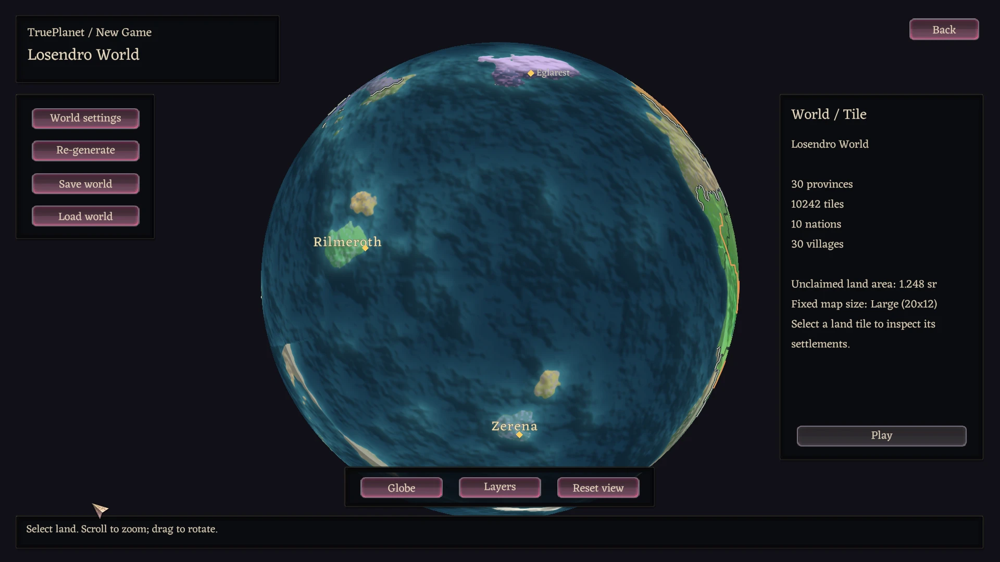
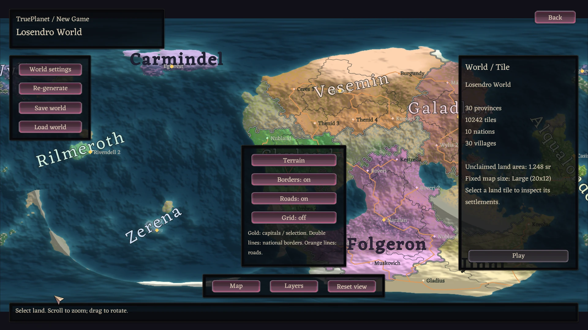

# TruePlanet

Play a Ruinarch campaign across a whole planet. Generate a globe of nations,
settlements, roads, and wilderness, choose where to begin, and travel between
local maps as you subjugate the world.

Your lord, Portal upgrades, currencies, and skill progression follow you.
Each place keeps its own villagers, buildings, minions, and damage when you leave.
TruePlanet works without Ruinarch+.

[Steam Workshop](https://steamcommunity.com/sharedfiles/filedetails/?id=3819054263)
| [Download 0.5.0](https://github.com/Xm0x/RuinarchMods/releases/tag/trueplanet-v0.5.0)

## Install

Requires [RuinarchModLoader 0.9.1 or newer](https://github.com/Xm0x/RuinarchModLoader).
Install the loader first, subscribe to TruePlanet on Steam Workshop, then restart
Ruinarch. The main-menu **Mods** window should list TruePlanet.

For a manual installation, download `TruePlanet-0.5.0.zip` from the release
and extract its `TruePlanet` folder into the game's `Mods/` folder instead
of subscribing on Workshop.

## Start a campaign

1. Choose **New Game** to open the globe.
2. Open **World settings** to choose a seed, land percentage, nations, and map size.
   Use **Re-generate** to try another world.
3. Drag to rotate the globe and scroll to zoom. Click land to inspect it, then
   click **Play** to begin there. Wilderness is playable too; oceans are not.
4. Place your Portal and choose your lord and starting loadout as in a normal game.

The same seed and world settings produce the same planet. A planet's local
map size applies everywhere in that world; it cannot be changed partway through
its campaign. Capitals have larger settlements than ordinary villages.

## Explore the atlas

Open **Planet atlas**, beside **Achievements**, during play. Select another
land tile and click **Travel**. Your current map is saved before you leave.
Return to a place to continue with its existing inhabitants and buildings.

Your first Portal is your main base. On first visits to other lands, choose where
to place a **Travel Portal**; you do not choose another lord or starting loadout.
Portal level, upgrades, currencies, and portable skill progression follow you.
Idle minions stay at your main base. You can still summon a minion where you
need one using its normal skill.

Use **Globe / Map** to switch between the globe and a flat map. Dragging pans
the flat map. **Layers** lets you show terrain, national colors, borders,
roads, and the tile grid. **Reset view** returns to your selected location,
or to your current campaign location if nothing is selected.
Press **Escape** to close an open panel, then the atlas.

## Send expeditions

Visit a destination and place its Travel Portal before sending a raid there.
At your main base, open a Kennel's party selector, choose a raid behavior and
the destination settlement, then select your leader and followers. The party
walks to your main Portal before leaving; pausing the game pauses its departure.

Raiders and defenders fight on the destination map even while you watch another
land. Deaths and damage are kept. Surviving raiders return through the Portals;
successful snatch parties bring their captive back to the main base. Visiting a
map with an expedition lets you watch and continue that same fight.

Only one offscreen expedition runs at a time. Other inactive lands remain
paused. Expeditions pause with the game.

## Win the campaign

Subjugate every settled tile on the planet. The objective tracks your progress
and the opposition at your current location. Wilderness does not count as a target.

You do not have to kill villagers who worship you or belong to allied factions.
A place becomes contested again if opposition returns. Your progress is kept
when you save, load, or travel.

If a Portal is destroyed, you can continue while you hold a Portal elsewhere.
Return to the lost location to replace its Portal. Losing your final held
Portal ends the campaign.

## Settings and saves

**World settings > Advanced** controls province count, tile detail, land
percentage, nation count, wilderness, and local map size. **Standard** tile
detail uses fewer planet tiles than **Detailed** and is the lighter option.
These choices apply when generating a world.

Set your defaults under **Settings > Mods > TruePlanet**.
**Save world / Load world** saves or opens a planet before starting play.
After starting a campaign, use Ruinarch's normal save and load controls.

## Requirements and compatibility

Offscreen expeditions run another copy of the game's simulation and use
substantial extra memory. Small local maps are the lighter choice, especially
when sending parties while playing elsewhere. Large maps and Detailed tile
detail also require more resources. Travel still has a loading screen.

On Linux, use Proton-GE for offscreen expeditions. On Windows, enable
**Developer Mode** so the game can create the private data links they need.
If an expedition stops with an error, reload the campaign to resume its saved
checkpoint rather than sending the same party again.

Newly generated mountains have sparse cave passages. Where a passage meets a
neighboring land, both maps have matching openings. Existing maps keep their
saved terrain rather than being regenerated.

Back up your saves before updating. Campaign data is stored alongside native
saves in `Ruinarch Game Saves/TruePlanet/`; keep that folder when moving or
backing up a campaign. Do not downgrade a campaign saved with 0.5.0 to 0.4.0.

Older province-based worlds keep their original maps and victory rules.
Do not open a campaign saved with TruePlanet 0.3.1 or later in version 0.3.0;
that older version cannot preserve its planet-wide conquest progress.

Report problems through [GitHub issues](https://github.com/Xm0x/RuinarchMods/issues).
Include your TruePlanet and loader versions, what you were doing, and whether
the problem happens in a new campaign or an existing save.

TruePlanet is an independent fan-made mod. Ruinarch and its assets belong to
their respective owners.
